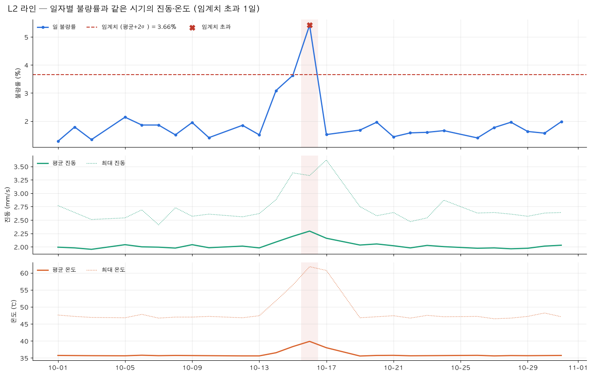
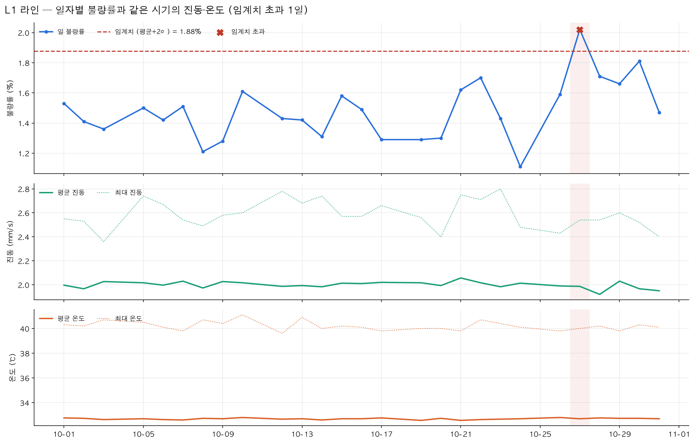
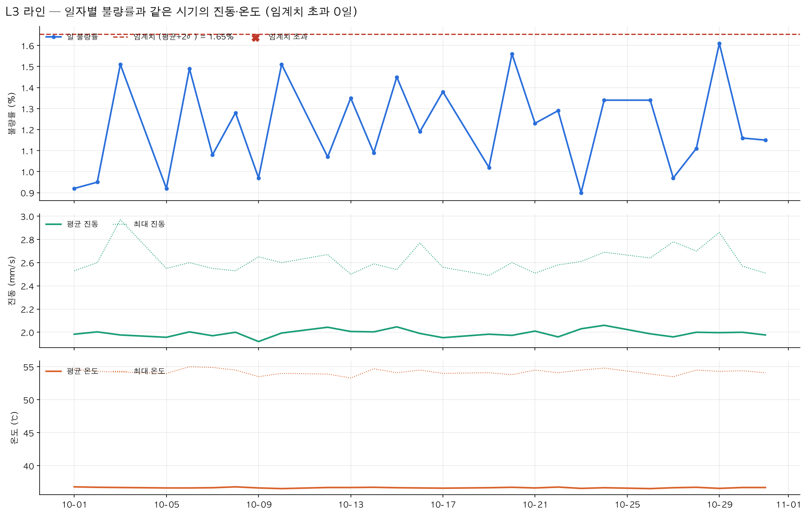

# 🏭 설비 고장 전 이상 신호 탐지 — 생산 DB × Python 미니 프로젝트

> **상-2 미션** · "설비고장 나기 전에 온도나 진동에 이상 신호가 있었는지 확인해봐."

가상의 가전 조립공장(냉장고 L1 · 세탁기 L2 · 에어컨 L3) **2026년 10월 합성 데이터**로,
불량률 급등 시점과 설비 센서(온도·진동)를 연결해 **고장 전 이상 신호**를 찾았습니다.


---

## 📌 핵심 결과

> **L2 드럼 용접기(EQ-201)의 온도는 실제 고장보다 약 54시간 먼저 이상 신호를 보냈습니다.**

| | 내용 |
|---|---|
| 🔍 **발견** | 10월 중 불량률이 임계치를 넘은 날은 **L2 10/16(5.42%)**, **L1 10/27(2.02%)** 이틀 |
| 🌡️ **이상 신호** | EQ-201 평균 온도 45.0℃ → 57.5℃, 평균 진동 2.01 → 2.95mm/s (10/16) |
| ⏱️ **조기 진단** | 일 단위로는 고장 당일에야 잡히지만, **교대 단위**로는 10/14 야간, **시각 단위 센서**로는 10/14 15:00에 이상이 잡힘 |
| 🛠️ **고장 확인** | `downtime_log`: 10/16 20:59 설비고장 → 10/17 150분 정비 후 불량률 1.52%로 정상화 |

### 이상 신호 타임라인 (L2 · EQ-201)

```
10/14 15:00  🌡️ 온도 기준(48.8℃) 초과      ← 센서 · 1시간 단위   ◀ 가장 이른 신호
10/14 19:00  📳 진동 기준(2.79mm/s) 초과    ← 센서 · 1시간 단위
10/14 야간   📈 불량률 3.54%                ← 생산 · 교대 단위
10/16        🚨 일 불량률 5.42%              ← 생산 · 일 단위 (일 판정에서 처음 '이상')
10/16 20:59  ❌ 설비고장 (31분)
10/17 09:05  ❌ 설비고장 (150분) → 품질점검 → 불량률 정상화
```



<sub>L2는 10/14부터 온도·진동이 먼저 오르고, 10/16 불량률이 임계치(3.66%)를 넘었습니다. 붉은 음영은 임계치 초과일입니다.</sub>

---

## 🧭 분석 방법

| 단계 | 내용 |
|---|---|
| 1. 불량률 집계 | 일자·라인별 `Σ불량 / Σ생산 × 100` (SQL) |
| 2. 임계치 판정 | 라인별 **평균 + 2σ** 초과 시 '이상' → `quality_judgment`에 기록 |
| 3. 센서 집계 | 설비·일자별 온도·진동 **평균 / 최댓값** (`sensor_hourly`) |
| 4. 시각화 | 불량률 · 진동 · 온도를 x축(날짜)을 공유하는 3단 그래프로 비교 |
| 5. 조기 진단 | 불량률은 교대 단위, 센서는 1시간 단위로 다시 보고 `downtime_log` 고장 시각과 비교 |

**라인별 판정 결과 (k=2)**

| 라인 | 임계치 | 이상일 |
|---|---:|---|
| L1 냉장고 | 1.88% | 10/27 · 2.02% |
| L2 세탁기 | 3.66% | 10/16 · 5.42% |
| L3 에어컨 | 1.65% | 없음 |

<details>
<summary>📈 L1 · L3 그래프 보기</summary>


<sub>L1은 10/27 불량률이 임계치를 넘었지만 온도·진동 변화는 없음 → 센서 외 요인 추가 확인 필요</sub>


<sub>L3는 10월 내내 불량률·센서 모두 안정</sub>

</details>

---

## 💡 제안

1. 설비 감시는 **센서 1시간 단위**, 불량률은 **교대 단위**로 모니터링
2. 시간 단위 값은 잡음이 많으므로 **"3σ 초과가 N시간 연속되면 경보"** 같은 연속 조건 적용
3. **추가 확인 필요**: EQ-201의 다른 고장 4건(10/6, 10/22, 10/26, 10/28)에서도 같은 신호가 앞섰는지, L1 10/27 불량 원인(불량 유형·모델·근태)

---

## 🔧 트러블슈팅

| 문제 | 원인 | 해결 |
|---|---|---|
| 불량률이 모두 0 | PostgreSQL 정수 ÷ 정수 → 소수점 버림 | `defect_qty::numeric / nullif(prod_qty, 0)` |
| `column "equip_code" is ambiguous` | 조인한 두 테이블에 같은 이름의 열 | 별칭 지정 `s.equip_code = e.equip_code` |
| SQL 결과를 변수 2개로 받으면 열 이름이 들어감 | `q()`는 DataFrame 반환 | `.iloc[0].astype(float)` (Decimal → float) |
| 재실행 시 중복키 에러 | `quality_judgment` UNIQUE 제약 | `on conflict ... do update` |
| 설비 단위 값을 넣을 수 없음 | `quality_judgment`에 `equip_code` 열 없음 | `alter table`로 열 추가, 고유키 `(work_date, equip_code)`로 변경 |

---

## 📁 폴더 구조

```
.
├── readme.md
├── 14. 생산DB_Python연동.sql        # DB 생성 · 데이터 적재 스크립트
├── .env.example                      # DB 접속 정보 양식 (.env로 복사해 사용)
└── production-db-analysis/
    ├── report.html                   # 📄 전체 보고서
    ├── notebooks/상트랙_분석.ipynb    # 분석 노트북
    ├── images/                       # 그래프
    └── requirements.txt
```

## ▶️ 실행 방법

```bash
# 1) DB 생성: PostgreSQL에서 '14. 생산DB_Python연동.sql' 실행
# 2) 접속 정보 설정
cp .env.example production-db-analysis/.env   # 비밀번호 입력
# 3) 패키지 설치 후 노트북 실행
pip install -r production-db-analysis/requirements.txt
jupyter notebook production-db-analysis/notebooks/상트랙_분석.ipynb
```

📄 **전체 보고서**: [`production-db-analysis/report.html`](production-db-analysis/report.html) — 내려받아 브라우저로 열면 그래프와 함께 볼 수 있습니다.

---

<sub>※ 실습용 합성 데이터이며 실제 공장 수치가 아닙니다. · AI(Claude)에게 문법·개념 질문과 코드 예시를 받아, 데이터에 맞게 실행·검증했습니다.</sub>
